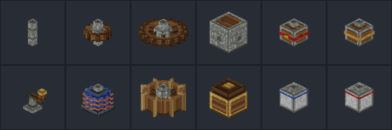
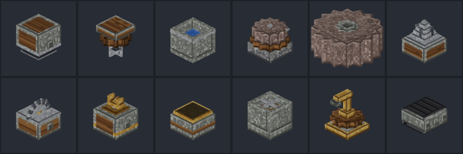
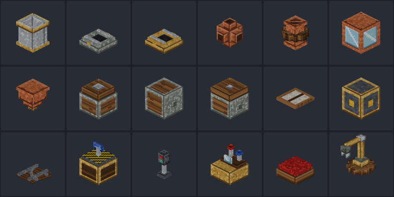

# CRAFTORIA: Mechanical Revolution

A kinetic-machinery add-on for **Minecraft Bedrock Edition 1.26+**, inspired by the Java mod *Create*.
Rotational power flows through shafts, cogwheels, gearboxes and belts into working machines,
processing lines, logistics, fluid handling and moving structures — all with original models,
textures, animations and synthesized sounds.

> Arabic documentation: [docs/GUIDE_AR.md](docs/GUIDE_AR.md) (player guide) · [docs/REPORT_AR.md](docs/REPORT_AR.md) (technical report)





## Install

1. Open `release/CRAFTORIA_Mechanical_Revolution_v1.0.0.mcaddon` on a device with Minecraft Bedrock 1.26.0 or newer
   (it imports a behavior pack and a resource pack).
2. Create or edit a world → **Behavior Packs** → activate *CRAFTORIA: Mechanical Revolution [BP]*
   (the resource pack is applied automatically as a dependency).
3. **No experimental toggles are required.** The add-on uses only stable APIs:
   `@minecraft/server` 2.5.0 and `@minecraft/server-ui` 2.0.0 (the stable versions shipped with 1.26.0),
   block format 1.21.110, entity format 1.21.90.

New players receive an **Engineer's Manual** (in-game guide + settings) on first join.

## What works

| Area | Content |
|---|---|
| Kinetic power | Shaft, Cogwheel, Large Cogwheel, Gearbox, Clutch, Gearshift, Speedometer, Stressometer. Real speed/direction propagation (gear ratios 1:2 / 2:1, reversing meshes, bevel gearbox), stress units (SU) with capacity vs. impact, clear fault states: *overstressed*, *jammed* (opposing sources / impossible gear loops), *overspeed* (>256 RPM). Faults stop the network — **nothing is destroyed** (unlike Create). |
| Generators | Hand Crank (32 RPM while turned, sneak to reverse, costs hunger), Water Wheel (reads water flow from `liquid_depth`, up to 8 RPM / 256 SU), Windmill Bearing (1 RPM per 8 sails, up to 16 RPM × 512 SU), Creative Motor (adjustable, creative only). |
| Processing (survival recipes) | Mechanical Press (pressing on depot/belt/ground, compacting in basin), Mechanical Mixer (needs 30 RPM; heated recipes need fire/campfire/lava/magma under the basin — e.g. brass), Basin (items + 2 fluids), Millstone, Crushing Wheels (pair, must turn inward, crush mobs too), Mechanical Drill, Mechanical Saw (fells whole trees; facing up it cuts items), Deployer (applies items to items, places blocks, bone-meals crops, attacks), Depot, Encased Fan (pushes entities; bulk washing through water, bulk smelting through lava/fire). |
| Logistics | Mechanical Belts (2–20 blocks, items ride and stop under processors, entities are carried, outputs to whatever is at the end), Chutes, Andesite/Brass Funnels (insert/extract, filters, redstone lock), Filter item, Mechanical Arm (inputs/outputs picked before placing, 5-block range, smooth articulated animation). Interoperates with vanilla chests, barrels, hoppers and furnaces. |
| Fluids | Fluid Pipes (auto-connecting), Mechanical Pump (direction follows rotation), Fluid Tank (8 buckets, level display), Spout (fills bottles/buckets/items on depots & belts), basin fluid I/O, infinite water from source blocks, lava consumed. |
| Moving structures | Super Glue (box regions), Mechanical Bearing (free rotation or **door mode** 90°/180°), Windmill Bearing, Rope Pulley + **Elevator Contacts** (call the elevator to a floor), Mechanical Piston + Extension Poles (bridges, sliding doors). Smooth rendering, players standing on vertical/linear platforms are carried, structures persist across reloads. |
| Trains (simplified) | Train Track (auto-connecting straights and 90° curves), Train Station (assemble/disassemble, automatic shuttle), Train Signal (red near other trains or when powered), Train Controls (drive with forward/back input), Seats. Every block follows the track smoothly through curves. |
| Tools | Wrench (rotate; sneak = pick up), Engineer's Goggles (look at a block: speed, stress, status, contents), Belt Connector, Super Glue, Filter, Engineer's Manual. |
| Materials | Zinc ore (world generation, stable feature rules), raw/ingot/nugget zinc, brass, sheets (iron/copper/brass/gold), andesite alloy, casings, crushed ores (+ washing/smelting chains), flour, dough, cinder flour, powdered obsidian, experience nuggets, precision mechanism, electron tube, whisk, propeller, brass hand. 104 crafting/furnace recipes + ~200 machine recipes. |

## Commands & settings

* `/craftoria:debug` – performance counters (networks, rotors, displays, active machines, task timings).
* `/craftoria:settings <rotors|sounds|particles|maxblocks> <value>` – world settings (also in the Manual → Settings, operators only).
* `/craftoria:rebuild` – respawn all animated parts.

**Low-end / Android tip:** set `rotors 0` to replace all animated parts with static models (the logic keeps working),
and `particles 1` or `0`.

## How it is built (performance design)

* **The world is the single source of truth.** Networks are re-derived from blocks; a reload, chunk reload or
  `/setblock` can never leave phantom power (a known problem of Create and of other Bedrock ports).
  Nodes in unloaded chunks count as absent; the add-on never force-loads chunks.
* **Incremental solver:** topology changes rediscover one component; generator changes only re-solve it.
  A 500-shaft network rediscovers in ≈6 ms (Node.js); speeds are pure data.
* **Client-side animation:** rotating parts are entities whose Molang computes the angle from the level time,
  so a turning cog costs zero server work and zero network traffic while its speed is constant. Rotors exist only
  within ~40 blocks of players (visual LOD); farther away the block's own static model is shown.
* **One scheduler** drives every system with per-task periods; only machines that have work are ticked.

See [docs/RESEARCH.md](docs/RESEARCH.md) and [docs/TESTING.md](docs/TESTING.md) for details.

## Honest limitations

* Not tested inside the game: this project was built without access to a Minecraft client or dedicated server.
  Verification was done with Mojang's official 1.26.0 JSON schemas, the TypeScript compiler against the official
  2.5.0 typings, a Molang linter, a software model renderer and 46 automated tests that run the real scripts in a
  simulated world. See [docs/TESTING.md](docs/TESTING.md).
* Items on belts/depots/arms are shown by entities holding the item; their exact on-screen orientation per item
  type could not be verified.
* Belts are horizontal only; no belt tunnels, smart chutes, upward chutes, hose pulley, item drain, mechanical
  crafter, sequenced assembly, gantries or chassis (Super Glue regions replace chassis).
* Rotating structures have no collision while moving; containers cannot be moved; drills/saws do not work on
  contraptions.
* Trains: flat track, 90° curves, no junctions/switches, simplified block signals and schedules.
* In-game text is English (Bedrock has no Arabic UI font/RTL support).

## Build from source

```bash
npm install
pip install --user numpy soundfile   # only to regenerate the synthesized sounds (already in assets/sounds)
python3 tools/sounds/generate_sounds.py
node tools/build.mjs --previews      # packs -> build/, add-on -> release/, previews -> build/previews
npm test                             # 46 tests (kinetics, machines, logistics, contraptions, trains, perf)
npm run typecheck
```

Optional: point `CRAFTORIA_SCHEMAS` at `metadata/json_schemas` of a `Mojang/bedrock-samples` checkout (tag `v1.26.0.2`)
to enable schema validation during the build (the schemas are not redistributed).

## Credits & license

Code, models, textures and sounds of CRAFTORIA are original work, released under the MIT License (see `LICENSE`).
Gameplay logic and several values are adapted from the *Create* mod's MIT-licensed source code
(© simibubi and contributors: RotationPropagator, KineticNetwork, stress defaults, press timing, block breaking,
millstone timing, belt speed, recipe structure). **No Create assets are used** — Create's textures/models are
All Rights Reserved and were not copied. CRAFTORIA is not affiliated with Create or Mojang.
